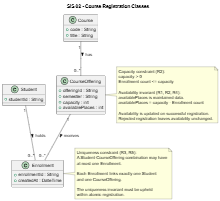
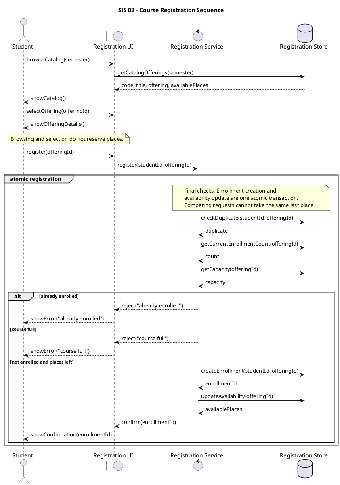
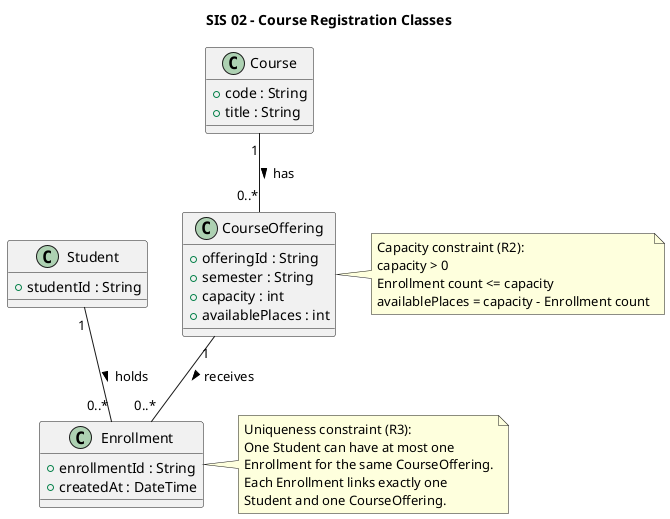
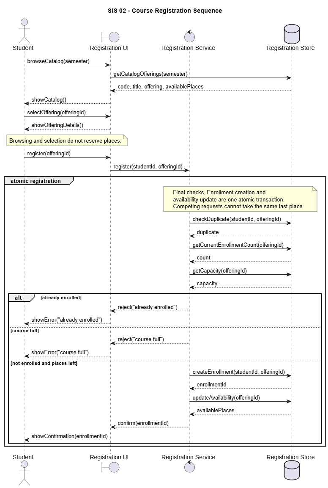
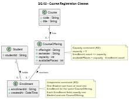

# SIS #02 — AI-Assisted UML Modeling: University Course Registration

<!--
  This is the only file you write your report in. README.md tells you what goes where.

  Rules the checker relies on:
  - Do not delete, rename or renumber the ## headings, the ### headings, or the **Label:** words.
  - Replace every "(write here)" and "(paste here)". None may be left when you submit.
  - Comments like this one are ignored by the checker and the word counter. Delete them or leave them.
-->

## 1. Scope and assumptions

<!-- Your FINAL scope statement and assumptions, after reviewing Prompt A's output. Say here
     what is out of scope (payments, prerequisites, timetable clashes, waiting lists,
     cancellation) — section 2 must not mention them. Section 10 keeps your first version. -->

**Scope:**  The university course registration system allows students to browse available courses and select course offerings for a semester. Students can register for different offerings one by one. Before registration, the system checks available places and prevents duplicate enrollments. Successful registrations are confirmed, while unsuccessful requests receive a clear explanation. Payments, prerequisites, timetable clashes, waiting lists, and cancellation are out of scope.

**Assumptions:**

1. Each student has a unique student ID and is already signed in.
2. Students register for one existing CourseOffering at a time. Each offering has a positive capacity.

## 2. User stories and acceptance criteria

<!-- Your APPROVED requirements: Prompt A's draft after your review. Keep the IDs, the three
     story headings and the bullet shape. Every criterion names the rule(s) it maps to,
     e.g. (R2, R4). Two criteria per story. Nothing out of scope.
     Format of a criterion, on one bullet:
     - **AC-03** (R2, R4): Given ..., When ..., Then ... -->

### US-01 — Browse offerings

**US-01:** As a student, I want to browse course offerings for a semester so that I can see available courses and places before registration.

- **AC-01** (R1): Given a student selects a semester, When the student opens the catalog, Then the system displays course codes, titles, offerings and available places.
- **AC-02** (R1, R2): Given a student views an offering, When the student selects it without registering, Then no place is reserved and availability must be rechecked during registration.

### US-02 — Register for an offering

**US-02:** As a student, I want to register for a selected offering so that I can receive confirmation of my enrollment.

- **AC-03** (R2, R3, R4): Given an offering has capacity 2 and zero enrollments, and the student is not enrolled, When the student requests registration, Then the system checks duplicates and capacity, creates exactly one Enrollment, updates the count to 1 and confirms registration.

- **AC-04** (R2, R3, R4): Given an offering has capacity 2 and one enrollment, and the student is not enrolled, When registration is requested, Then the system atomically checks duplicates and capacity, creates one Enrollment, updates the count to 2 and confirms registration.

### US-03 — Receive a clear rejection

**US-03:** As a student, I want to receive a clear rejection message so that I understand why my registration failed.

- **AC-05** (R3, R5): Given a student is already enrolled in an offering, When the student requests registration again, Then the system returns "already enrolled", creates no Enrollment and leaves the count unchanged.
- **AC-06** (R2, R5): Given the catalog previously showed a free place but the current offering is full, and the student is not enrolled, When registration is requested, Then the system returns "course full", creates no Enrollment and leaves the count unchanged.

## 3. Sequence diagram

<!-- The FINAL diagram, rendered. Change .png to .svg if that is what you exported. -->


**Participants:** Student is the user requesting registration. Registration UI handles user interaction. Registration Service processes registration rules. Registration Store manages course and enrollment data.

**Atomic operation:** The atomic registration group includes checkDuplicate, getCurrentEnrollmentCount, getCapacity, createEnrollment, and updateAvailability. These operations ensure that concurrent requests cannot exceed capacity. Browsing the catalog does not reserve a place.


**Where the Enrollment is created:** The Registration Service sends createEnrollment(studentId, offeringId) to the Registration Store in the successful registration branch. This creates an instance of the Enrollment class.

**Technical lifelines:** Registration UI, Registration Service, and Registration Store are technical lifelines representing application components. They do not appear in the domain class diagram because it describes domain entities rather than application architecture.

## 4. Class diagram

<!-- The FINAL diagram, rendered. -->



<!-- One row per association in classes.puml, read in both directions. -->


| Association | Read left to right | Read right to left |
| --- | --- | --- |
| Course — CourseOffering | One Course has zero or more CourseOfferings. | Each CourseOffering belongs to exactly one Course. |
| Student — Enrollment | One Student has zero or more Enrollments. | Each Enrollment belongs to exactly one Student. |
| CourseOffering — Enrollment | One CourseOffering has zero or more Enrollments. | Each Enrollment belongs to exactly one CourseOffering. |


**How an Enrollment links a student to an offering:** Each Enrollment connects exactly one Student with exactly one CourseOffering. The enrollment represents successful registration in a particular offering.

**Capacity constraint:** The enrollment count must not exceed CourseOffering.capacity. Available places equal capacity minus enrollment count. Multiplicity alone cannot express a changing capacity limit.

**Uniqueness constraint:** Each Student and CourseOffering pair can have at most one Enrollment. Multiplicity alone cannot prevent two Enrollment records from connecting the same student and offering.

## 5. Traceability

<!-- Every rule, including the catalog fields and availability (R1). Column 1: the rule and
     the criteria that cover it, e.g. "R2 + AC-03, AC-04". Column 2: the message, guard,
     class or constraint that shows the rule in YOUR diagrams. Column 3: the T-ID that
     exercises it, or the extra check you did instead (R1 has no T case). -->

| Rule and criterion | Model evidence | Validation case |
| --- | --- | --- |
| R1 + AC-01, AC-02 | getCatalogOfferings and showCatalog; Course.code, Course.title, CourseOffering.semester and availablePlaces | Additional catalog inspection |
| R2 + AC-02, AC-03, AC-04, AC-06 | getCurrentEnrollmentCount, getCapacity, atomic registration note, capacity constraint | T1, T2, T3 |
| R3 + AC-03, AC-04, AC-05 | checkDuplicate, already enrolled branch, Enrollment uniqueness note | T4 |
| R4 + AC-03, AC-04 | createEnrollment, updateAvailability, confirm | T1, T2 |
| R5 + AC-05, AC-06 | reject("already enrolled"), reject("course full"), no state-changing messages in rejection branches | T3, T4 |

## 6. Walkthroughs

| Case | Observed path and state change | Judgment and evidence |
| --- | --- | --- |
| T1. Available | Student requests registration. Service calls checkDuplicate, getCurrentEnrollmentCount and getCapacity. With count 0 and capacity 2, the success branch creates one Enrollment, updates availability and confirms registration. Count 0 → 1. | Pass — "not enrolled and places left" branch, createEnrollment and updateAvailability. |
| T2. Last place | Student selects an offering with one place remaining. The service checks for duplicates and verifies current count 1 against capacity 2. It creates one Enrollment and updates availability. Count 1 → 2; available places become 0. | Pass — atomic registration group and successful creation branch. |
| T3. Full | The catalog previously showed availability. Student requests registration, but getCurrentEnrollmentCount returns 2 and getCapacity returns 2. The course full branch rejects the request. No Enrollment is created. Count 2 → 2. | Pass — "course full" branch and atomic operation note. |
| T4. Duplicate | Student requests the same offering again. checkDuplicate returns true. The already enrolled branch returns an error without creating an Enrollment or updating availability. Count remains 1 → 1. | Pass — "already enrolled" branch and uniqueness constraint. |

## 7. Review decisions

| AI suggestion or model element | Decision | Reason | Rule |
| --- | --- | --- | --- |
| Capacity guard conditions | Modified | I added explicit conditions to the atomic registration note because the previous model did not clearly explain how the current enrollment count determined success or rejection. | R2, R5 |
| Explicit transaction messages | Rejected | The assignment permits an atomic group and explanatory note, so implementation-specific transaction messages are unnecessary for this UML model. | R2, R4 |
| Available places consistency | Modified | I clarified that availablePlaces is maintained data updated together with successful Enrollment creation, preventing inconsistencies between availability and enrollment count. | R1, R2, R4 |
| Duplicate registration protection | Modified | I clarified uniqueness for each Student-CourseOffering pair because association multiplicities alone cannot prevent duplicate enrollment records. | R3, R5 |
| Prompt B missing approved requirements | Rejected retrospective change | The original Prompt B did not include the complete approved stories and acceptance criteria. I kept the actual AI exchange unchanged instead of rewriting the prompt after receiving the response. | R1–R5 |
## 8. Modeling explanation

<!-- 200–300 words. Your main design choices; how the class diagram and the sequence diagram
     complement each other; why an activity diagram could also help explain the workflow. -->

The purpose of my UML models is to describe how students register for university course offerings. I used a sequence diagram and a class diagram because they represent different aspects of the system.

The sequence diagram shows how registration works step by step. First, a student opens the course catalog and selects an offering. The system displays course information and available places. However, browsing the catalog does not reserve a place because availability can change before registration.

When the student requests registration, the system checks whether the student is already enrolled and whether there are available places. These checks and enrollment creation happen as one atomic operation. This prevents multiple students from taking the same last available place.

The sequence diagram includes three possible outcomes. If the student is already enrolled, the system rejects the request. If the course is full, registration is also rejected. Otherwise, the system creates one Enrollment, updates available places and sends confirmation.

The class diagram describes the structure of the system. It includes four classes: Student, Course, CourseOffering and Enrollment. Each Enrollment connects one Student to one CourseOffering. The diagram also shows associations and their multiplicities.

I added separate notes for capacity and uniqueness because multiplicities alone cannot represent these restrictions. This makes the system requirements clearer.

An activity diagram could also be useful because it would show the registration workflow as decisions and actions. It could make the success and rejection paths easier to understand without focusing on individual system messages.

## 9. Reflection

<!-- 150–200 words. Written by you, not by the assistant: where AI helped, one decision you
     made yourself, one remaining limitation. Specific beats flattering. -->
During this assignment, I used ChatGPT to help create user stories, acceptance criteria, and UML diagrams for a university course registration system. AI helped me understand how to connect system requirements with UML models. However, I noticed that the first diagrams were not perfect and needed additional review.

I checked the diagrams against the requirements and four test cases. One decision I made was to keep the atomic registration group instead of adding detailed database transaction messages. I think this was a better choice because the assignment focuses on UML modeling rather than implementation details.

I also clarified how the system checks available places and prevents duplicate registrations. These changes made the diagrams easier to understand.

One limitation of AI is that it can generate diagrams that look correct but still contain unclear conditions. Also, UML notes describe the rules but do not guarantee that real software will enforce them.

This assignment helped me understand that AI is useful for creating initial models, but students still need to review the results, make decisions, and verify their correctness.

## 10. Appendix A — Before AI

<!-- Written BEFORE you run Prompt A, committed and pushed in your first commit, and never
     edited afterwards. This is what you paste into Prompt A as "My initial assumptions". -->

**Scope:**  The system allows students to browse available courses and select course offerings for a semester. Students can register for multiple offerings one by one. The system checks available places, prevents duplicate registrations, and confirms successful enrollments.

**Initial assumptions:**

1. Each student has a unique student ID.
2. Students register for one CourseOffering at a time, even when selecting multiple courses.

## 11. Appendix B — AI exchanges

<!-- Complete prompts and complete responses, as text — never screenshots. Paste each inside
     the ~~~~ block that follows its label: AI responses contain ``` PlantUML blocks, and
     ~~~~ keeps them from breaking this file. Prompts B and C: the prompt text first, then
     the material it refers to ("below", "these two") pasted under it, in the same block.
     You may add B5, B6 … after B4 if you ran more. -->

### B1 — Requirements (Prompt A)

- **Tool:** ChatGPT
- **Model:** GPT-6
- **Date:** 2026-10-18
- **Purpose:** draft 3 user stories and 6 acceptance criteria

<!-- Model: the exact model with its version, as the tool shows it (e.g. "GPT-5 Thinking",
     "Claude Sonnet 4.5"). If the tool does not show it, write: not displayed
     Date: YYYY-MM-DD -->

**Prompt:**

~~~~text
Act as a requirements analyst. Use only this course registration scenario and rules R1–R5:

A student browses an electronic course catalog, chooses a course offering and requests registration. Each offering has a limited number of places. A Course describes a subject. A CourseOffering is one scheduled section in one semester. Registration always targets a specific offering. Assume that the student is signed in, the selected offering exists, and its capacity is a positive whole number.

R1. Catalog: Show the course code, title, offering and available places for one semester.

R2. Capacity: Recheck current availability when registering. Enrollment must never exceed the offering's capacity.

R3. Duplicates: A student may have at most one enrollment in the same offering. Reject a repeat request.

R4. Success: Create exactly one Enrollment linking the student and offering, update availability and return a confirmation.

R5. Rejection: Explain "course full" or "already enrolled". Create no enrollment and leave the enrollment count unchanged.

A catalog view does not reserve a place. Model the final checks and enrollment creation as one atomic operation, so competing requests cannot take the same last place. A note describing it is enough. Out of scope: payments, prerequisites, timetable clashes, waiting lists, cancellation. Use fictional students and courses. Treat any extra AI suggestion as a proposal you accept or reject explicitly.

My initial assumptions are:
1. Each student has a unique student ID.
2. Students register for one CourseOffering at a time, even when selecting multiple courses.

Draft 3 user stories and 2 Given / When / Then acceptance criteria for each. Use IDs US-01 to US-03 and AC-01 to AC-06. Map each criterion to rule IDs.

Cover normal and rejection behavior. List uncertainty separately. Do not add excluded features or invent university policies.
~~~~

**Response:**

~~~~text
### US-01 — Browse Course Catalog

As a student, I want to browse available courses and offerings for a semester so that I can see course information and available places before registration.

### US-02 — Register for Course Offering

As a student, I want to register for a selected course offering so that I can receive confirmation when a place is available.

### US-03 — Handle Registration Rejections

As a student, I want to receive a clear explanation when my registration is rejected so that I understand why I cannot enroll in the selected offering.

### Acceptance Criteria

AC-01 — View catalog (R1)
Given a student is signed in and selects a semester, When the student browses the course catalog, Then the system displays the course code, title, course offering and available places for that semester.

AC-02 — Catalog does not reserve places (R1, R2)
Given a student views an offering with available places, When the student selects the offering without completing registration, Then no Enrollment is created, no place is reserved, and availability must be rechecked when registration is requested.

AC-03 — Successful registration (R2, R3, R4)
Given an offering has capacity 2 and enrollment count 0, and the student is not enrolled, When the student requests registration, Then the system checks for duplicates and available capacity, creates exactly one Enrollment, updates the count to 1 and confirms registration.

AC-04 — Register for the last available place (R2, R4)
Given an offering has capacity 2 and enrollment count 1, and the student is not enrolled, When the student requests registration, Then the system performs the final checks and enrollment creation atomically, creates exactly one Enrollment, updates the count to 2 and confirms registration.

AC-05 — Duplicate registration (R3, R5)
Given a student is already enrolled in an offering, When the student requests registration for the same offering again, Then the system rejects the request with "already enrolled", creates no Enrollment and leaves the enrollment count unchanged.

AC-06 — Course full (R2, R5)
Given the catalog previously showed an available place but the current enrollment count equals the offering capacity, and the student is not enrolled, When the student requests registration, Then the system rechecks current capacity, rejects the request with "course full", creates no Enrollment and leaves the count unchanged.

### Uncertainty
1. The assignment does not specify the exact format of student identifiers.
2. The assignment does not define additional enrollment statuses.
3. The implementation technology for atomic registration is not specified. The UML model will represent atomic registration without choosing a specific database or locking mechanism.
No out-of-scope features were added.
~~~~

### B2 — UML drafts (Prompt B)

- **Tool:** ChatGPT
- **Model:** GPT-6
- **Date:** 2026-10-18
- **Purpose:** draft the sequence and class diagrams

**Prompt:**

~~~~text
Using my approved scenario, R1–R5, stories and criteria below, return separate PlantUML code blocks for a sequence diagram and a domain class diagram.
Sequence: include catalog browsing and guarded success, full-course and duplicate outcomes. Model final checks and creation as one atomic operation.
Class: show domain concepts, useful attributes and multiplicities. State the capacity and uniqueness constraints. Explain assumptions and any technical lifelines.
~~~~

**Response:**

~~~~text
## Sequence Diagram
The diagram shows browsing, selection and registration. The Registration UI, Service and Store are technical lifelines.



## Class Diagram
The diagram shows the four required domain classes, their associations, capacity and uniqueness notes.



The sequence diagram describes the interaction order and outcomes. The class diagram describes domain entities, their attributes and multiplicities. The technical UI, Service and Store lifelines do not need to appear as domain classes. Browsing reserves no place and final checks and creation are atomic.
~~~~

### B3 — Model critique (Prompt C)

- **Tool:** ChatGPT
- **Model:** GPT-6
- **Date:** 2026-10-18
- **Purpose:** review both models against R1–R5 and T1–T4

**Prompt:**

~~~~text
Review these two UML models against R1–R5 and my acceptance criteria. Check message order, guards, state changes, multiplicities and naming.
Inspect the four validation cases: available places, exactly one place, full course after a stale catalog view, and duplicate registration.
For each issue, cite the affected rule and model element. Explain the impact and propose a focused correction. Separate genuine defects from optional design choices.

FOLLOW-UP IN THE SAME NEW CHAT, AFTER THE ASSISTANT REQUESTED THE MODELS:

Here are my original UML models, rules R1–R5, and approved acceptance criteria. Please perform the concrete model critique requested in my previous message.

RULES:
R1. Catalog: Show the course code, title, offering and available places for one semester.
R2. Capacity: Recheck current availability when registering. Enrollment must never exceed the offering's capacity.
R3. Duplicates: A student may have at most one enrollment in the same offering. Reject a repeat request.
R4. Success: Create exactly one Enrollment linking the student and offering, update availability and return a confirmation.
R5. Rejection: Explain "course full" or "already enrolled". Create no enrollment and leave the enrollment count unchanged.
Catalog viewing does not reserve a place. Final registration checks and creation must be atomic.

MODEL 1 — ORIGINAL SEQUENCE DIAGRAM:


MODEL 2 — ORIGINAL CLASS DIAGRAM:


APPROVED ACCEPTANCE CRITERIA:
AC-01 (R1): Given a student selects a semester, When the student opens the catalog, Then the system displays course codes, titles, offerings and available places.
AC-02 (R1, R2): Given a student views an offering, When the student selects it without registering, Then no place is reserved and availability must be rechecked during registration.
AC-03 (R2, R3, R4): Given an offering has capacity 2 and zero enrollments, and the student is not enrolled, When the student requests registration, Then the system checks duplicates and capacity, creates exactly one Enrollment, updates the count to 1 and confirms registration.
AC-04 (R2, R3, R4): Given an offering has capacity 2 and one enrollment, and the student is not enrolled, When registration is requested, Then the system atomically checks duplicates and capacity, creates one Enrollment, updates the count to 2 and confirms registration.
AC-05 (R3, R5): Given a student is already enrolled in an offering, When the student requests registration again, Then the system returns "already enrolled", creates no Enrollment and leaves the count unchanged.
AC-06 (R2, R5): Given the catalog previously showed a free place but the current offering is full, and the student is not enrolled, When registration is requested, Then the system returns "course full", creates no Enrollment and leaves the count unchanged.

Please identify genuine defects separately from optional design choices. For every finding, provide the affected rule, exact model element, impact and proposed correction. Check T1, T2, T3 and T4.
~~~~

**Response:**

~~~~text
I can review both UML models against R1–R5 and your acceptance criteria, but I need the two UML models and the exact requirements to identify genuine defects without guessing.

Please upload the diagrams or paste their PlantUML, along with R1–R5 and the acceptance criteria. If these are in a previous file, you can upload it here.

I’ll structure the review as follows:

## 1. Model-by-model defect review

For each issue, I’ll identify:

| Check          | What I’ll verify                                                                             |
| -------------- | -------------------------------------------------------------------------------------------- |
| Message order  | Whether messages occur in the required sequence                                              |
| Guards         | Whether conditions are correct, complete, and applied at the right decision point            |
| State changes  | Whether successful and failed operations leave the system in valid states                    |
| Multiplicities | Whether relationships permit the required number of objects and prevent invalid associations |
| Naming         | Whether operations, states, messages, and relationships consistently match the requirements  |

Each finding will include the affected rule (R1–R5 or a specific acceptance criterion), the exact model element, the impact, and a focused correction.

## 2. Four validation cases

I’ll trace each case through both models, checking the expected behavior against the modeled messages, guards, and state changes.

Case 1 — Available places

Verify that registration succeeds when places are available and that the remaining capacity is updated correctly.

Case 2 — Exactly one place

Verify boundary behavior: the last available place can be claimed, and capacity does not become negative.

Case 3 — Full course after a stale catalog view

Verify that the system checks current capacity during registration rather than trusting outdated catalog information.

Case 4 — Duplicate registration

Verify that an existing registration is detected and that a duplicate cannot be created, including when the request is repeated.

## 3. Genuine defects vs. optional design choices

I’ll classify findings separately:

- Genuine defect: The model violates a stated rule, fails an acceptance criterion, or permits an invalid outcome.
- Potential defect: The model is ambiguous or omits behavior needed to establish compliance.
- Optional design choice: The model differs from a possible implementation but still satisfies the stated requirements.

I’ll finish with a prioritized list of corrections, keeping each change as small as possible and avoiding unrelated redesign.

Send the two models and requirements, and I’ll provide the concrete, element-by-element review rather than a generic UML checklist.

# UML critique: SIS 02 — Course Registration

The two models are mostly aligned with R1–R5, but there are several important issues to distinguish: missing decision logic, transaction semantics, capacity consistency, and multiplicity constraints. The sequence diagram describes the intended flow, while the class diagram captures the main entities and associations; neither diagram alone proves that the implementation enforces all the requirements.

I’ll use these four validation cases:

- T1: Available places — capacity 2, zero enrollments.
- T2: Exactly one place — capacity 2, one existing enrollment.
- T3: Stale catalog — the catalog showed a place, but the offering is now full.
- T4: Duplicate registration — the student is already enrolled.

## 1. Genuine defects and ambiguities

### Finding 1 — The sequence diagram does not explicitly define the capacity guard

Genuine defect

- Affected rule: R2, R5; AC-03, AC-04, AC-06.
- Model element: Model 1, `alt course full` and `else not enrolled and places left`.

Problem: The diagram retrieves `count` and `capacity`, but does not explicitly show the condition that determines whether the course is full. It also does not state that the count used for the decision is the current count inside the atomic transaction.

Impact: The diagram is ambiguous about whether a full offering is rejected when `count == capacity`, and whether a stale availability value could allow an extra enrollment.

Focused correction: Add explicit guards based on current transactional data:

```
else [count >= capacity]
    Service --> UI : reject("course full")
else [count < capacity]
    Service -> Store : createEnrollment(studentId, offeringId)
```

Keep the duplicate check as the first decision, so an already-enrolled student receives the required `"already enrolled"` response even if the course is full.

### Finding 2 — Atomicity is asserted in a note but not shown as transaction operations

Genuine defect

- Affected rule: R2, R4, R5; AC-04, AC-06.
- Model element: Model 1, `group atomic registration`, particularly the calls to `checkDuplicate`, `getCurrentEnrollmentCount`, `getCapacity`, `createEnrollment` and `updateAvailability`.

Problem: The note says that checks, enrollment creation and the availability update form one atomic transaction, but the sequence has no explicit transaction start, commit, or rollback. A UML note documents an intention; it does not demonstrate how competing requests are prevented from taking the same last place.

Impact: If two requests both observe one remaining place, both might pass the check and create enrollments unless the transaction uses appropriate locking, isolation, or a database constraint.

Focused correction: Show the transaction boundary explicitly, with commit only after successful enrollment creation and the availability update. On rejection or a failed write, roll back or leave the transaction without changes. State that the capacity check and creation are serialized or protected by equivalent concurrency control.

### Finding 3 — The class diagram does not enforce the capacity invariant

Genuine defect

- Affected rule: R2, R4, R5; AC-03, AC-04, AC-06.
- Model element: Model 2, `CourseOffering` attributes `capacity`, `availablePlaces`, and the note `Enrollment count <= capacity`.

Problem: The note states the correct invariant, but it does not specify how the invariant is enforced when multiple registration requests occur concurrently. The diagram also does not identify a constraint preventing the enrollment count from exceeding capacity.

Impact: The class model describes a valid state but does not establish that invalid states are prevented. Two simultaneous requests could exceed capacity if enforcement is left to an unchecked application-level condition.

Focused correction: Keep the invariant, but specify that registration must enforce it atomically. The implementation should use a suitable transaction and concurrency-control mechanism, with a database constraint or equivalent protection where feasible. A simple constraint on an individual `Enrollment` row is not sufficient to enforce a limit on the total number of enrollments.

### Finding 4 — The `availablePlaces` update is ambiguous because availability is also defined as a derived value

Model ambiguity

- Affected rule: R1, R2, R4, R5; AC-01, AC-03, AC-04, AC-06.
- Model elements:
  - Model 1: `updateAvailability(offeringId)`
  - Model 2: `CourseOffering.availablePlaces`
  - Model 2 note: `availablePlaces = capacity - Enrollment count`

Problem: The class diagram defines `availablePlaces` as a value derived from capacity and enrollment count, but the sequence diagram explicitly updates it. These designs can both work, but the model does not explain whether the field is stored or calculated.

Impact: If the count changes but the stored availability does not, the catalog may show incorrect places. If availability is derived, the separate update operation may be unnecessary.

Focused correction: Choose one consistent design:

- Derived availability: Calculate `capacity - current enrollment count` when displaying the catalog; remove the separate `updateAvailability` call.
- Stored availability: Keep `updateAvailability`, but update the enrollment and availability together in the same transaction and maintain the invariant that the values agree.

Either approach must ensure that rejected requests leave the enrollment count and availability unchanged.

### Finding 5 — Duplicate registration prevention is stated, but its enforcement mechanism is unspecified

Model ambiguity

- Affected rule: R3, R4, R5; AC-03, AC-05.
- Model elements:
  - Model 1: `checkDuplicate(studentId, offeringId)`
  - Model 2: the `Enrollment` uniqueness constraint note.

Problem: The sequence checks for a duplicate, but a check alone is not enough when two identical requests arrive concurrently. Both requests could find no existing enrollment before either creates one.

Impact: The system could create two `Enrollment` records for the same student and offering, violating R3 and the requirement to create exactly one enrollment.

Focused correction: Enforce uniqueness on the pair `(studentId, offeringId)` at the persistence layer, or use an equivalent concurrency-safe mechanism. Keep the service-level duplicate check so it can return `"already enrolled"`; handle a uniqueness conflict without creating a second enrollment or changing the count.

### Finding 6 — The class diagram's multiplicities are broadly correct, but do not enforce the duplicate constraint

Partial modeling gap

- Affected rule: R3, R4; AC-03, AC-05.
- Model elements: Model 2, associations `Student "1" -- "0..*" Enrollment` and `CourseOffering "1" -- "0..*" Enrollment`.

Problem: These multiplicities correctly express that each enrollment is associated with exactly one student and one offering, while each student and offering may have zero or more enrollments. However, they do not prevent two enrollments from connecting the same student to the same offering.

Impact: A model can satisfy both association multiplicities while violating the one-enrollment-per-student-per-offering rule.

Focused correction: Keep the multiplicities and add a formal uniqueness constraint on the student–offering pair. The existing note expresses the intended rule, but the implementation must enforce it.

## 2. Validation of T1–T4 against both models

## T1

Available places: capacity 2, zero enrollments

Expected: success

- Sequence: The intended success branch creates an enrollment, updates availability, and confirms registration.
- Class: The intended result is one enrollment, with one place remaining.
- Assessment: The expected outcome is consistent with R2 and R4. The sequence still needs an explicit capacity guard and clear transaction semantics.
- Expected result: Enrollment count = 1; available places = 1; confirmation returned.

## T2

Exactly one place: capacity 2, one existing enrollment

Expected: success

- Sequence: Registration should succeed when the current count is 1 and capacity is 2.
- Class: Two enrollments are permitted by the `0..*` multiplicity and satisfy the stated capacity constraint.
- Assessment: No inherent multiplicity defect. Correctness depends on atomic capacity enforcement.
- Expected result: Enrollment count = 2; available places = 0; confirmation returned.

## T3

Stale catalog: current offering is full

Requires explicit guard

- Sequence: The catalog is read before registration, which correctly reflects AC-02. However, the registration flow must reject when the current count is at capacity.
- Class: The capacity invariant describes the desired limit but does not itself enforce it.
- Assessment: The model states the right intention, but the guard and concurrency enforcement are insufficiently explicit.
- Expected result: `"course full"`; no enrollment created; count unchanged; no availability change.

## T4

Duplicate registration

Requires enforced uniqueness

- Sequence: The duplicate check precedes the capacity check, and the rejection branch returns `"already enrolled"`. This is the correct decision order.
- Class: The uniqueness note expresses R3, but multiplicities alone cannot enforce it.
- Assessment: The ordinary duplicate path is modeled correctly. Concurrent duplicate requests still require persistence-level protection.
- Expected result: `"already enrolled"`; no new enrollment; count unchanged.

## 3. Naming and optional design choices

These are not automatically defects; they should be clarified only where they affect correctness or consistency.

| Model element                                            | Assessment                                         | Suggested improvement                                                                                   |
| -------------------------------------------------------- | -------------------------------------------------- | ------------------------------------------------------------------------------------------------------- |
| `offering` vs. `offeringId`                              | Minor naming inconsistency                         | Use `offeringId` for identifiers and `CourseOffering` for the entity.                                   |
| `count` vs. `availablePlaces`                            | Different concepts, but the distinction is unclear | Name the count `currentEnrollmentCount` and define availability as `capacity - currentEnrollmentCount`. |
| `reject("course full")` and `reject("already enrolled")` | Consistent with R5                                 | Retain the exact required messages.                                                                     |
| `Enrollment.createdAt`                                   | Optional attribute                                 | Keep it if the system needs a registration timestamp.                                                   |
| `Course "1" -- "0..*" CourseOffering`                    | Appropriate multiplicity                           | No correction needed for the stated requirements.                                                       |
| `Student "1" -- "0..*" Enrollment`                       | Appropriate multiplicity                           | Keep it, with the additional uniqueness constraint.                                                     |
| `CourseOffering "1" -- "0..*" Enrollment`                | Appropriate multiplicity                           | Keep it; enforce capacity separately.                                                                   |

## 4. Recommended corrections, in priority order

1. Make the guards explicit. Check duplicates first; then reject when `currentEnrollmentCount >= capacity`; otherwise attempt registration.
2. Make atomicity operational. Protect the current-capacity check and enrollment creation from concurrent requests. Commit successful changes together; ensure rejection leaves state unchanged.
3. Enforce uniqueness. Protect `(studentId, offeringId)` against duplicates, including concurrent requests.
4. Resolve availability storage. Either calculate availability from capacity and enrollment count or update the stored value transactionally.
5. Retain the current multiplicities. They correctly express the basic relationships; do not change them to try to solve capacity or duplicate enforcement.

Overall verdict: Neither diagram needs a wholesale redesign. The principal problems are not the basic entities or associations; they are the gap between stated constraints and enforced behavior, especially under concurrent registration. T1 and T2 follow the intended success path, while T3 and concurrent versions of T4 expose the most important risks.
~~~~

### B4 — Focused revision (Prompt D)

- **Tool:** ChatGPT
- **Model:** GPT-6
- **Date:** 2026-10-18
- **Purpose:** apply my accepted review decisions

**Prompt:**

~~~~text
Revise the UML sources using only my accepted review decisions: 1. MODIFY — capacity guard (R2, R5): clarify in a sequence note that the full branch applies when currentEnrollmentCount >= capacity and the success branch when currentEnrollmentCount < capacity after checking duplicate=false. Preserve the assignment's exact three alt labels "already enrolled", "course full", and "not enrolled and places left", and DO NOT add square brackets. Evidence: Prompt C Finding 1; AC-04 and AC-06 require a current count, rather than a stale catalog count.
2. REJECT — explicit beginTransaction/commit/rollback messages (R2, R4): keep the existing "group atomic registration" and atomic note, and clarify that final checks, creation and availability update are indivisible. Evidence: Prompt C Finding 2, but the assignment expressly accepts a note describing atomicity; extra technical messages are unnecessary for a domain-level model.
3. MODIFY — availability consistency (R1, R2, R4): treat CourseOffering.availablePlaces as maintained data with the invariant availablePlaces = capacity - Enrollment count; retain updateAvailability inside the same atomic group as createEnrollment and make the note precise. Evidence: Prompt C Finding 4; success must update availability, and rejections must leave it unchanged.
4. MODIFY — duplicate safety and notes (R3, R5): preserve all three association multiplicities, clarify that the Student-CourseOffering combination is unique for Enrollment and that the invariant must be upheld inside atomic registration. Evidence: Prompt C Findings 5 and 6; multiplicities alone do not express pairwise uniqueness. Avoid adding implementation-specific database policies or extra classes.
Keep justified existing elements and explain each change.
Preserve the agreed scope and rule IDs. Return both updated PlantUML blocks and a concise change log. Flag any unresolved issue.
Approved requirements: R1. Catalog: Show the course code, title, offering and available places for one semester.
R2. Capacity: Recheck current availability when registering. Enrollment must never exceed the offering's capacity.
R3. Duplicates: A student may have at most one enrollment in the same offering. Reject a repeat request.
R4. Success: Create exactly one Enrollment linking the student and offering, update availability and return a confirmation.
R5. Rejection: Explain "course full" or "already enrolled". Create no enrollment and leave the enrollment count unchanged.

US-01: As a student, I want to browse course offerings for a semester so that I can see available courses and places before registration.
AC-01 (R1): Given a student selects a semester, When the student opens the catalog, Then the system displays course codes, titles, offerings and available places.
AC-02 (R1, R2): Given a student views an offering, When the student selects it without registering, Then no place is reserved and availability must be rechecked during registration.

US-02: As a student, I want to register for a selected offering so that I can receive confirmation of my enrollment.
AC-03 (R2, R3, R4): Given an offering has capacity 2 and zero enrollments, and the student is not enrolled, When the student requests registration, Then the system checks duplicates and capacity, creates exactly one Enrollment, updates the count to 1 and confirms registration.
AC-04 (R2, R3, R4): Given an offering has capacity 2 and one enrollment, and the student is not enrolled, When registration is requested, Then the system atomically checks duplicates and capacity, creates one Enrollment, updates the count to 2 and confirms registration.

US-03: As a student, I want to receive a clear rejection message so that I understand why my registration failed.
AC-05 (R3, R5): Given a student is already enrolled in an offering, When the student requests registration again, Then the system returns "already enrolled", creates no Enrollment and leaves the count unchanged.
AC-06 (R2, R5): Given the catalog previously showed a free place but the current offering is full, and the student is not enrolled, When registration is requested, Then the system returns "course full", creates no Enrollment and leaves the count unchanged.
Original sources:

models/original/sequence.puml:


models/original/classes.puml:


My review decisions and evidence: 1. MODIFY — capacity guard (R2, R5): clarify in a sequence note that the full branch applies when currentEnrollmentCount >= capacity and the success branch when currentEnrollmentCount < capacity after checking duplicate=false. Preserve the assignment's exact three alt labels "already enrolled", "course full", and "not enrolled and places left", and DO NOT add square brackets. Evidence: Prompt C Finding 1; AC-04 and AC-06 require a current count, rather than a stale catalog count.
2. REJECT — explicit beginTransaction/commit/rollback messages (R2, R4): keep the existing "group atomic registration" and atomic note, and clarify that final checks, creation and availability update are indivisible. Evidence: Prompt C Finding 2, but the assignment expressly accepts a note describing atomicity; extra technical messages are unnecessary for a domain-level model.
3. MODIFY — availability consistency (R1, R2, R4): treat CourseOffering.availablePlaces as maintained data with the invariant availablePlaces = capacity - Enrollment count; retain updateAvailability inside the same atomic group as createEnrollment and make the note precise. Evidence: Prompt C Finding 4; success must update availability, and rejections must leave it unchanged.
4. MODIFY — duplicate safety and notes (R3, R5): preserve all three association multiplicities, clarify that the Student-CourseOffering combination is unique for Enrollment and that the invariant must be upheld inside atomic registration. Evidence: Prompt C Findings 5 and 6; multiplicities alone do not express pairwise uniqueness. Avoid adding implementation-specific database policies or extra classes.
~~~~

**Response:**

~~~~text
Below are the revised PlantUML sources for the SIS 02 – Course Registration model. They apply only your accepted review decisions, preserve rules R1–R5, retain the existing classes, association multiplicities, and three exact sequence `alt` labels, and avoid explicit transaction messages or implementation-specific database policies.

## 1. Updated sequence diagram

File: `models/original/sequence.puml`

```

@startuml
title SIS 02 - Course Registration Sequence

actor Student
boundary "Registration UI" as UI
control "Registration Service" as Service
database "Registration Store" as Store

Student -> UI : browseCatalog(semester)
UI -> Store : getCatalogOfferings(semester)
Store --> UI : code, title, offering, availablePlaces
UI --> Student : showCatalog()

Student -> UI : selectOffering(offeringId)
UI --> Student : showOfferingDetails()

note over Student, UI
Browsing and selection do not reserve places.
Displayed availability may change before registration.
end note

Student -> UI : register(offeringId)
UI -> Service : register(studentId, offeringId)

group atomic registration
note over Service, Store
Final duplicate and capacity checks, Enrollment creation,
and availability update are indivisible.

Use the current enrollment count and capacity:
- duplicate = true: reject as already enrolled.
- duplicate = false and currentEnrollmentCount >= capacity:
  reject as course full.
- duplicate = false and currentEnrollmentCount < capacity:
  create exactly one Enrollment and update availability.

The Student-CourseOffering uniqueness invariant must be
upheld within atomic registration. Rejected requests create
no Enrollment and leave the enrollment count and availability
unchanged.

On success, availablePlaces = capacity - Enrollment count.
Competing requests cannot exceed the offering's capacity.
end note

Service -> Store : checkDuplicate(studentId, offeringId)
Store --> Service : duplicate

Service -> Store : getCurrentEnrollmentCount(offeringId)
Store --> Service : currentEnrollmentCount

Service -> Store : getCapacity(offeringId)
Store --> Service : capacity

alt already enrolled
    Service --> UI : reject("already enrolled")
    UI --> Student : showError("already enrolled")
else course full
    Service --> UI : reject("course full")
    UI --> Student : showError("course full")
else not enrolled and places left
    Service -> Store : createEnrollment(studentId, offeringId)
    Store --> Service : enrollmentId
    Service -> Store : updateAvailability(offeringId)
    Store --> Service : availablePlaces
    Service --> UI : confirm(enrollmentId)
    UI --> Student : showConfirmation(enrollmentId)
end
end

@enduml

```

## 2. Updated class diagram

File: `models/original/classes.puml`

```

@startuml
title SIS 02 - Course Registration Classes

class Student {
    +studentId : String
}

class Course {
    +code : String
    +title : String
}

class CourseOffering {
    +offeringId : String
    +semester : String
    +capacity : int
    +availablePlaces : int
}

class Enrollment {
    +enrollmentId : String
    +createdAt : DateTime
}

Course "1" -- "0..*" CourseOffering : has >
Student "1" -- "0..*" Enrollment : holds >
CourseOffering "1" -- "0..*" Enrollment : receives >

note right of CourseOffering
Capacity constraint (R2):
capacity > 0
Enrollment count <= capacity

Availability invariant (R1, R2, R4):
availablePlaces is maintained data.
availablePlaces = capacity - Enrollment count

Availability is updated on successful registration.
Rejected registration leaves availability unchanged.
end note

note right of Enrollment
Uniqueness constraint (R3, R5):
A Student-CourseOffering combination may have
at most one Enrollment.

Each Enrollment links exactly one Student
and one CourseOffering.

The uniqueness invariant must be upheld
within atomic registration.
end note

@enduml

```

## 3. Change log

| Decision                                  | Changes made                                                                                                                                                                                                                                              |
| ----------------------------------------- | --------------------------------------------------------------------------------------------------------------------------------------------------------------------------------------------------------------------------------------------------------- |
| 1. MODIFY — Capacity guard                | Added a sequence note defining the current-count conditions for rejection and success. Preserved the exact three `alt` labels without square brackets.                                                                                                    |
| 2. REJECT — Explicit transaction messages | Retained `group atomic registration` and the atomicity note. Clarified that final checks, enrollment creation, and availability updates are indivisible. No `beginTransaction`, `commit`, or `rollback` messages were added.                              |
| 3. MODIFY — Availability consistency      | Kept `availablePlaces` on `CourseOffering` and defined it as maintained data equal to capacity minus the enrollment count. Kept `updateAvailability` inside the atomic group and specified that rejection leaves availability unchanged.                  |
| 4. MODIFY — Duplicate safety              | Preserved all three association multiplicities. Clarified pairwise uniqueness for each Student–CourseOffering combination and required that invariant to hold within atomic registration. No extra classes or database-specific policies were introduced. |

## 4. Unresolved issue

The sequence diagram's branch conditions are documented but not explicitly guarded by UML `alt` conditions. This preserves your assignment's exact labels and avoids square brackets, as requested. The accompanying note explains the intended behavior, but a reader must use that note to understand the conditions.

The diagrams also express atomicity and uniqueness as model constraints rather than specifying their implementation. That is consistent with your approved scope.

The revised models preserve the agreed requirements:

- R1: Catalog details and available places for a semester.
- R2: Current capacity check and no over-enrollment.
- R3: At most one enrollment per student per offering.
- R4: One enrollment, updated availability, and confirmation on success.
- R5: Clear rejection, no enrollment creation, and unchanged count on failure.
~~~~

## 12. Appendix C — Original diagrams

<!-- The AI's first output from Prompt B, rendered unedited from models/original/. -->






## 13. Appendix D — References and source checks

### References

- PlantUML. Sequence Diagram. https://plantuml.com/sequence-diagram (accessed 2026-10-18).
- PlantUML. Class Diagram. https://plantuml.com/class-diagram (accessed 2026-10-18).

### Source checks

| Modeling decision | Source and locator | What the source says | How it supports or changed your model |
| --- | --- | --- | --- |
| Using alt and else for registration outcomes | PlantUML, Sequence Diagram, section "Grouping message", https://plantuml.com/sequence-diagram, accessed 2026-10-19 | The documentation explains how alt and else represent alternative paths in sequence diagrams. | I used three alternatives to show successful registration, duplicate rejection and full-course rejection. |
| Showing associations and constraints | PlantUML, Class Diagram, sections "Label on relations" and "Notes and stereotypes", https://plantuml.com/class-diagram, accessed 2026-10-19 | The documentation explains multiplicities on class relationships and how notes can describe additional constraints. | I used multiplicities for the relationships between classes and separate notes for capacity and uniqueness constraints. |

