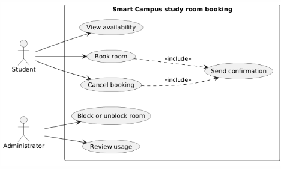

# Lab report — Practice #03, Requirements Engineering with AI

Fill in every section. **Do not delete or renumber the headings** — the README points at them and a
missing heading reads as a missing section.

Name: Perizat Zhengiskyzy
Student ID:24b031038
GitHub username:https://github.com/perizatzhengiskyzy

---

## 1. Setup

| | |
| --- | --- |
| AI assistant (tool) | ChatGPT|
| Exact model name and version |GPT-5.6 Luna|
| Date of the session | 27.09.2026|
| Diagram renderer used | |

One tool and one model for all three prompts. If you switched, say why here — it changes what your
findings mean.

---

## 2. Original AI output — user stories (Part 1)

Paste the **unedited** response to Prompt 1. Do not tidy it. If it is long, paste all of it anyway;
this is the baseline everything else is measured against.

```
### Student Goals

* Find available study rooms quickly.
* Book a suitable room for a specific time.
* View and manage personal bookings.
* Cancel a booking when the room is no longer needed.

### Administrator Goals

* Manage study rooms and their availability.
* Monitor and manage room bookings.
* Prevent booking conflicts and maintain accurate room schedules.

### User Stories

| # | User story                                                                                                                                   | Priority | Assumption                                                         |
| - | -------------------------------------------------------------------------------------------------------------------------------------------- | -------- | ------------------------------------------------------------------ |
| 1 | **As a Student, I want to view available study rooms, so that I can choose a suitable room.**                                                | High     | Room availability is stored in the system.                         |
| 2 | **As a Student, I want to book an available study room for a selected time, so that I can reserve it for studying.**                         | High     | Students can select from available time slots.                     |
| 3 | **As a Student, I want to view my current bookings, so that I can remember when and where I have reserved a room.**                          | Medium   | The system stores each student's bookings.                         |
| 4 | **As a Student, I want to cancel my booking, so that the room becomes available when I no longer need it.**                                  | Medium   | Students can cancel their own bookings.                            |
| 5 | **As an Administrator, I want to view all study room bookings, so that I can monitor room usage.**                                           | High     | Administrators have access to booking information.                 |
| 6 | **As an Administrator, I want to manage study room availability, so that students can book only rooms that are available.**                  | High     | Administrators can update room availability.                       |
| 7 | **As an Administrator, I want to manage bookings, so that booking information remains accurate.**                                            | High     | Administrators are authorized to modify or cancel bookings.        |
| 8 | **As an Administrator, I want the system to prevent conflicting bookings, so that two users cannot reserve the same room at the same time.** | High     | A room cannot have more than one booking for the same time period. |

```

---

## 3. Story review (Part 2)

One row per change you made. "Kept unchanged" is a valid row and needs a reason too.

| Story (as generated) | What I did | Why | Final ID |
| --- | --- | --- | --- |
|Story 1 – View available study rooms |Rewrote the assumption | The original assumption says availability is stored in the system, which introduces an implementation detail not defined by the scenario. The story itself matches UC-01.|US-01|
|Story 2 – Book an available study room|Kept unchanged|The story uses the Student actor, describes one clear and testable goal, and matches UC-02 Book room without adding out-of-scope functionality.|US-02|
|Story 3 – View my current bookings|Deleted|Viewing personal bookings is not one of the six use cases defined in the scenario. The AI introduced functionality that is not supported by the supplied scope|N/A|
|Story 4 – Cancel my booking |Kept unchanged |The story uses the Student actor, describes one clear and testable goal, and matches UC-03 Cancel booking. The assumption is also consistent with the scenario because a student cancels a booking they made. |US-03|
|Story 5 – View all study room bookings |Rewrote the story and assumption |The scenario defines UC-05 as reviewing how rooms are used over a period, not viewing all bookings. I changed the story to match the defined use case more precisely. |US-04|
|Story 6 – Manage study room availability |Rewrote the story and assumption |“Manage availability” is broader than the supplied scenario. I changed it to the specific UC-04 behavior: block or unblock a room. The assumption now reflects R4. |US-05|
|Story 7 – Manage bookings |Deleted |The scenario does not give the Administrator a function to modify or cancel bookings. The assumption invents Administrator permissions that are not supported by any of the six defined use cases. |N/A |
|Story 8 – Prevent conflicting bookings |Rewrote the story and changed the actor to Student |Preventing overlapping bookings is R3, but the generated story incorrectly assigned this responsibility to the Administrator. I rewrote it as a Student booking goal constrained by R3. |US-06 |

**Did the assistant invent anything outside the scenario?** Name it against the out-of-scope list in
README section 1, or write "no, and here is how I checked".

Yes. The assistant invented functionality outside the supplied scenario. Story 3 introduced viewing personal bookings, which is not one of the six defined use cases. Story 7 also assumed that Administrators can modify or cancel bookings, but the scenario does not give the Administrator this responsibility. I identified these by comparing every generated story with UC-01 to UC-06 and the scope restrictions in README section 1.

**How many stories did you end with, and why that number?**

I ended with 6 user stories because this is within the required range of 6–8. I removed unsupported functionality and kept or revised stories that could be traced to the supplied scenario and business rules. UC-06 Send confirmation currently has no separate user story, which I will record as a traceability gap rather than inventing an additional story only to cover it.

---

## 4. Original AI output — acceptance criteria (Part 3)

```
### US-02 — Book an available study room

**Assumptions:**

* Students can select from available future time slots.
* A booking can last a maximum of 2 hours.
* A room cannot have overlapping bookings.
* Blocked rooms cannot be booked.

**Acceptance Criteria:**

1. **Successful booking**

   * **Given** a student selects an available room and a future time slot
   * **When** the student confirms the booking
   * **Then** the system creates the booking successfully.

2. **Future booking validation**

   * **Given** a student selects a time that is in the past or starts now
   * **When** the student tries to confirm the booking
   * **Then** the system rejects the booking and asks the student to select a future time.

3. **Maximum duration**

   * **Given** a student selects a booking longer than two hours
   * **When** the student tries to confirm the booking
   * **Then** the system rejects the booking and indicates that the maximum duration is two hours.

4. **Overlapping booking**

   * **Given** the selected room already has a booking during the requested time
   * **When** the student tries to confirm the booking
   * **Then** the system rejects the booking and indicates that the room is unavailable.

5. **Blocked room**

   * **Given** the selected room is blocked
   * **When** the student tries to book it
   * **Then** the system rejects the booking and indicates that the room cannot be booked.

---

### US-03 — Cancel a booking

**Assumptions:**

* Students can cancel only their own bookings.
* A cancelled booking releases the room for other students.
* The booking exists in the system before cancellation.

**Acceptance Criteria:**

1. **Successful cancellation**

   * **Given** a student has an active booking
   * **When** the student selects cancel
   * **Then** the system cancels the booking and makes the time slot available.

2. **Own booking validation**

   * **Given** a booking belongs to another student
   * **When** the student tries to cancel it
   * **Then** the system rejects the cancellation.

3. **Non-existent booking**

   * **Given** the student selects a booking that does not exist or has already been cancelled
   * **When** the student tries to cancel it
   * **Then** the system displays an error and does not create a cancellation.

---

### US-05 — Block or unblock a study room

**Assumptions:**

* Only administrators can block or unblock rooms.
* A blocked room cannot be booked.
* An unblocked room can become available for booking if it has no other restrictions.

**Acceptance Criteria:**

1. **Successful blocking**

   * **Given** an administrator selects an available study room
   * **When** the administrator blocks the room
   * **Then** the system marks the room as blocked and prevents new bookings.

2. **Successful unblocking**

   * **Given** a study room is blocked
   * **When** the administrator unblocks it
   * **Then** the system marks the room as available for booking.

3. **Blocked-room validation**

   * **Given** a room is blocked
   * **When** a student tries to book the room
   * **Then** the system rejects the booking.

4. **Unauthorized action**

   * **Given** a user is not an administrator
   * **When** the user tries to block or unblock a room
   * **Then** the system rejects the action and does not change the room status.

```

---

## 5. Criteria review (Part 3)

| Criterion (as generated) | Problem | What I changed it to | Final ID |
| --- | --- | --- | --- |
|US-02 Maximum duration |It tests only a duration longer than two hours and does not test the exact two-hour boundary |Added a criterion confirming that a booking lasting exactly two hours is accepted. |AC-01 |
|US-02 Overlapping booking |It does not define whether a booking starting exactly when another booking ends is an overlap. |Clarified that a booking may start exactly when the previous booking for the same room ends |AC-02 |
|US-05 Unauthorized action | It introduces a generic “user” and authorization behavior that is not defined in the supplied scenario. The scenario has exactly two actors and authentication is out of scope. |Removed this criterion because it introduces behavior outside the supplied scenario| N/A |

**The two open questions.** Write your decision and the reason. Either answer is accepted.

| Question | My decision | Why |
| --- | --- | --- |
| A booking ending exactly when another begins — overlap under R3? | allowed |The bookings do not share any time interval, so I decided that the second booking may start exactly when the first one ends. |
| Is exactly two hours allowed under R2? | allowed|R2 says a booking lasts “at most two hours”, so I interpret exactly two hours as permitted. |

**Which invalid or boundary case did the assistant leave out?**

The assistant did not cover two important boundary cases for US-02: a booking lasting exactly two hours and a booking starting exactly when another booking for the same room ends. I decided that both cases are allowed and added criteria to make these boundaries explicit.

---

## 6. Original AI output — use-case diagram (Part 4)

```
@startuml
left to right direction

actor Student
actor Administrator

rectangle "Smart Campus Study Room Booking System" {

    usecase "View availability" as UC1
    usecase "Book room" as UC2
    usecase "Cancel booking" as UC3
    usecase "Block or unblock room" as UC4
    usecase "Review usage" as UC5
    usecase "Send confirmation" as UC6
}

Student --> UC1
Student --> UC2
Student --> UC3

Administrator --> UC4
Administrator --> UC5

UC2 ..> UC1 : <<include>>
UC2 ..> UC6 : <<include>>

@enduml
```

Rendered diagram (image, or a link): 

---

## 7. Diagram review (Part 4)

| Element | Problem | What I changed |
| --- | --- | --- |
| UC-02 → UC-01 `<<include>>` | The assistant made View availability a required part of Book room, but the scenario does not state that viewing availability must always be performed as part of booking. | Removed the `<<include>>` relationship between UC-02 and UC-01. |
| UC-03 → UC-06 | The assistant connected Send confirmation to Book room but omitted the same behavior for Cancel booking. UC-06 states that the system confirms a booking or a cancellation. | Added `UC-03 ..> UC-06 : <<include>>`. |

**Associations.** Which actor–use-case links did the assistant draw that a person does not actually
trigger? Name them.

None. The assistant connected Student only to View availability, Book room, and Cancel booking, and Administrator only to Block or unblock room and Review usage. It did not connect an actor directly to Send confirmation. The incorrect association I identified was the use-case relationship UC-02 → UC-01, not an actor–use-case association.

**Did any screen, database or internal component appear as a use case or an actor?**

No. The generated diagram contained only the two required actors, Student and Administrator, and the six required use cases. No screens, databases, or internal components were added.
---

## 8. Traceability (Part 5)

Summarise what the table in `requirements/traceability.md` shows:

- Use cases with **no story** behind them: UC-06 Send confirmation.
- Stories with **no use case** they belong to: none.
- Criteria that test **no rule** from section 1: AC-06, AC-07, AC-08, and AC-10 do not directly test R1–R4. They test the required behavior of UC-03 Cancel booking and UC-04 Block or unblock room. AC-09 and AC-11 relate to R4 because they cover the behavior of a blocked room.

**What does the largest gap tell you about the generated requirements?**

The largest gap is UC-06 Send confirmation because it has no user story or acceptance criteria behind it. The diagram includes it because it is one of the six required use cases, but the generated and revised user stories did not capture confirmation as a separate requirement. This shows that the generated requirements do not provide complete traceability for every required system function. I recorded the gap instead of creating an additional story only to hide it.

---

## 9. Checker runs

Paste the **real terminal output** of both runs. A table with nothing behind it does not count.

```
$ python tests/check_requirements.py
(paste)
```
$ python tests/check_requirements.py
PASS   US-1  user-stories.md         no placeholders left
PASS   US-2  user-stories.md         6 stories, IDs US-01…US-06
PASS   US-3  user-stories.md         every story has the required sentence shape
PASS   US-4  user-stories.md         every story has a priority
PASS   US-5  user-stories.md         every story declares an assumption
PASS   US-6  user-stories.md         only Student and Administrator appear as roles
PASS   US-7  user-stories.md         nothing from the out-of-scope list appears
PASS   AC-1  acceptance-criteria.md  no placeholders left
PASS   AC-2  acceptance-criteria.md  three sections, all naming real stories: US-02, US-03, US-05
PASS   AC-3  acceptance-criteria.md  every section has 3 to 5 uniquely numbered criteria
PASS   AC-4  acceptance-criteria.md  all 11 criteria are complete Given/When/Then
PASS   AC-5  acceptance-criteria.md  every section covers an invalid or boundary case
PASS   AC-6  acceptance-criteria.md  4 assumptions listed before the criteria
PASS   AC-7  acceptance-criteria.md  both open questions are settled in the assumptions
PASS   PU-1  use-cases.puml          valid PlantUML block, no placeholders
PASS   PU-2  use-cases.puml          exactly two actors: Student, Administrator
PASS   PU-3  use-cases.puml          all six use cases present
PASS   PU-4  use-cases.puml          system boundary present
PASS   PU-5  use-cases.puml          no screens, databases or internal components
PASS   PU-6  use-cases.puml          no unjustified actor associations found
PASS   TR-1  traceability.md         all six use cases have a row
PASS   TR-2  traceability.md         every ID in the table resolves
PASS   TR-3  traceability.md         every story appears in the table
------------------------------------------------------------------------
23 PASS · 0 FAIL · 0 ERROR   (23 checks)
Shape is clean. This says nothing about whether the requirements are good.

```
$ python tests/validate_submission.py
(paste)
```
$ python tests/validate_submission.py
submission.yml — submission.yml
------------------------------------------------------------------------
PASS   schema                                    1
PASS   week                                      03
PASS   student.name                              Perizat Zhengiskyzy
PASS   student.student_id                        24B031038
PASS   student.github                            perizatzhengiskyzy
PASS   assistant.tool                            ChatGPT
PASS   assistant.model                           GPT-5.6 Luna
PASS   counts.user_stories                       6
PASS   counts.acceptance_criteria_sets           3
PASS   checker                                   23 PASS · 0 FAIL · 0 ERROR
NOTE   checker                                   you are claiming a clean run — it will be re-run at your commit, so make sure it is true
PASS   checker.commit                            5f38321
PASS   assumptions.overlap_touching_bookings     allowed
PASS   assumptions.exactly_two_hours             allowed
PASS   traceability.use_cases_not_covered        UC-06
PASS   traceability.stories_not_traced           []
PASS   review_findings                           3 findings
PASS   review_findings[1]                        UC-02 included UC-01 View availability even though the scena…
PASS   review_findings[2]                        UC-03 was missing an include relationship to UC-06 Send conf…
PASS   review_findings[3]                        UC-06 Send confirmation has no supporting user story or acce…
PASS   honesty.can_explain_everything_submitted  yes
PASS   honesty.ai_usage_disclosed                yes
------------------------------------------------------------------------
21 PASS · 0 FAIL · 0 ERROR · 1 note
Shape is fine. This says nothing about whether the work is good.

```

| | PASS | FAIL | ERROR |
| --- | --- | --- | --- |
| `check_requirements.py` | 23 | 0 | 0 |

Commit these numbers were produced at (`git rev-parse --short HEAD`): '5f38321'

**Every FAIL, one line each: what it is and what you decided to do about it.** 

None. The final requirements checker run produced 0 FAIL and 0 ERROR.

**Did you run the checks by hand instead of with Python?** 

No. I ran the provided Python checkers.

---

## 10. Conclusion (150–200 words)

Answer all three:

1. Which part of the generated requirements was most wrong, and how would you have caught it without
   a checker?
2. What did the assistant get right that would have taken you noticeably longer by hand?
3. You are handing these requirements to someone who will implement them, and you will not be in the
   room. Which single one would you rewrite first, and why?

The most problematic part of the generated requirements was the use-case diagram. The assistant added an `<<include>>` relationship from UC-02 Book room to UC-01 View availability, although the scenario did not say that viewing availability must always be a required part of booking. It also connected UC-06 Send confirmation to booking but missed the confirmation after cancellation. Without the checker, I would have caught these problems by comparing every actor, use case, and relationship in the diagram with the fixed scenario and business rules.

The assistant was useful for generating the first versions of the user stories and acceptance criteria. It quickly produced structured requirements with roles, goals, assumptions, and Given/When/Then criteria. Writing the same first draft manually would have taken me noticeably longer.

If I were handing these requirements to a developer, I would rewrite UC-06 Send confirmation first. In my final traceability table, UC-06 has no supporting user story or acceptance criteria. This creates ambiguity about exactly when confirmation must be sent and what behavior is expected. I would clarify this requirement before implementation instead of leaving the developer to make assumptions.